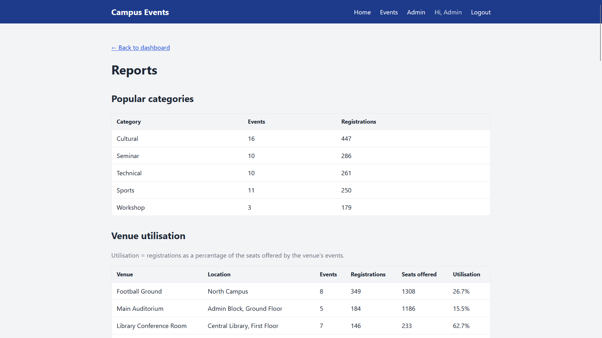
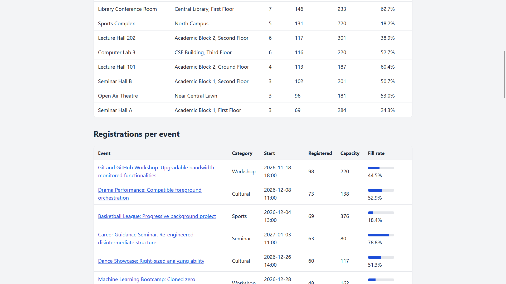
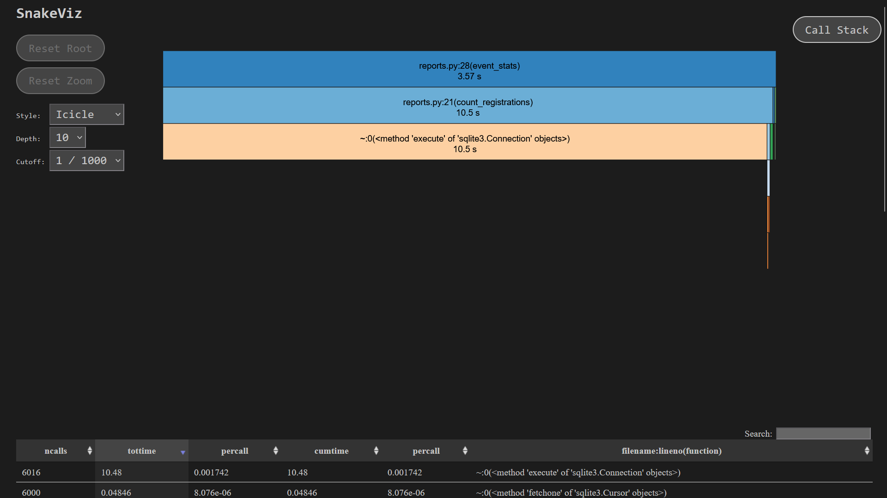

# Campus Event Management Platform

A Flask + SQLite web app where students browse and register for campus events, and admins manage events, venues, participants and reports.

Solo course project for **CS 202C** (November 2026) by **Prajyot**.

---

## Course modules covered

| Module | Where it is used |
|---|---|
| **HTML/CSS** | Jinja2 templates in [`app/templates/`](app/templates/) (a shared `base.html` layout plus pages that extend it) and one hand-written stylesheet [`app/static/style.css`](app/static/style.css) (CSS variables, flexbox, grid, responsive tables; no Bootstrap or Tailwind) |
| **Python** | Flask app in [`app/`](app/): app factory, Blueprints (`auth`, `events`, `admin`), Flask-Login, Werkzeug password hashing, `csv` export, Faker seed command, cProfile profiling scripts in [`profiling/`](profiling/) |
| **SQL** | Raw SQL through Python's built-in `sqlite3` (no ORM): [`sql/schema.sql`](sql/schema.sql) (tables, `UNIQUE`, `CHECK`, foreign keys, `ON DELETE CASCADE`), [`sql/indexes.sql`](sql/indexes.sql), parameterised queries with `?`, `JOIN` + `GROUP BY` reports, `EXPLAIN QUERY PLAN` |
| **Git** | Small commits using the `feat:` / `fix:` / `test:` / `perf:` / `chore:` / `docs:` convention; `.gitignore` and `.gitattributes` (keeps LF line endings for Bash scripts) |
| **Bash** | Automation scripts in [`scripts/`](scripts/) for setup, running, seeding, testing, profiling and building the docs; all use `set -euo pipefail` and work in Git Bash on Windows and on Linux/macOS |
| **LaTeX** | Project report [`report/report.tex`](report/report.tex) (TikZ diagrams, listings, pgfplots) and Beamer slides [`report/slides.tex`](report/slides.tex) |

## Features

**Students**
- Register, log in and log out (passwords stored as salted hashes)
- Browse upcoming events with **seats left**
- Search and filter by keyword (title or description), category, venue and date range
- Register for an event; the app refuses if the event is full, has already started, or the student is already registered
- Cancel a registration; **My registrations** page

**Admins**
- Dashboard with quick counts
- Create, edit and delete **venues** and **events**
- Validation: end after start, event capacity ≤ venue capacity, and **no venue time clashes** (same venue, overlapping times)
- Participant list per event with **CSV export**
- **Reports**: registrations and fill rate per event, popular categories, venue utilisation

## Tech stack

Python 3 · Flask · Flask-Login · Werkzeug · SQLite (`sqlite3`, raw SQL) · Jinja2 · hand-written CSS · pytest · Faker · cProfile + snakeviz · Bash · LaTeX/Beamer

## Prerequisites

- **Python 3.10+** ([python.org](https://www.python.org/)). On Windows, tick "Add Python to PATH".
- **Git Bash** on Windows (comes with [Git for Windows](https://git-scm.com/)), or any Bash shell on Linux/macOS.
- Optional: a LaTeX distribution (MiKTeX / TeX Live) to build the report, or use [Overleaf](https://www.overleaf.com/).

## Installation

```bash
git clone <repository-url>
cd "Campus Event Management Platform"
./scripts/setup.sh
```

`setup.sh` finds a working Python, creates `venv/`, installs `requirements.txt`, creates the database (`instance/campus.db`), adds the indexes and creates the default admin account.
Re-running it **wipes the database**.

To choose your own admin login:

```bash
ADMIN_EMAIL=me@example.com ADMIN_PASSWORD=secret ./scripts/setup.sh
```

## Usage

| Command | What it does |
|---|---|
| `./scripts/run.sh` | Start the app at <http://127.0.0.1:5000> (`PORT=8000 ./scripts/run.sh` for another port) |
| `./scripts/seed.sh [N]` | Fill the database with fake data: 10 venues, 100 students, N events (default 50) and random registrations that never exceed capacity. Admins are kept. |
| `./scripts/test.sh` | Run all tests with `pytest -v` (extra arguments are passed on, e.g. `./scripts/test.sh -k clash`) |
| `./scripts/profile.sh <label> [N]` | Build a separate profiling database with N events (default 2000), profile the reports and search with cProfile, and save results in `profiling/<label>/` |
| `./scripts/build_docs.sh` | Compile the LaTeX report and slides to PDF (if LaTeX is installed) |

**Demo logins** (after `./scripts/setup.sh` and `./scripts/seed.sh`):

| Role | Email | Password |
|---|---|---|
| Admin | `admin@campus.local` | `admin123` |
| Student | `student1@campus.local` … `student100@campus.local` | `student123` |

## Folder structure

```
Campus Event Management Platform/
├── app/
│   ├── __init__.py        app factory: config, blueprints, error pages
│   ├── db.py              SQLite connection + init-db / add-indexes / create-admin commands
│   ├── auth.py            register, login, logout, admin_required decorator
│   ├── events.py          event list + search, detail, register/cancel, my registrations
│   ├── admin.py           dashboard, venue/event CRUD, clash check, participants, CSV, reports
│   ├── reports.py         report queries (JOIN + GROUP BY)
│   ├── seed.py            Faker seed command
│   ├── templates/         Jinja2 HTML templates (auth/, events/, admin/)
│   └── static/style.css   hand-written stylesheet
├── sql/
│   ├── schema.sql         tables and constraints
│   └── indexes.sql        performance indexes
├── scripts/               common.sh, setup.sh, run.sh, seed.sh, test.sh, profile.sh, build_docs.sh
├── tests/                 pytest fixtures (conftest.py) and 45 tests
├── profiling/             run_profile.py, explain.py, RESULTS.md, before/, rewrite_only/, after/
├── report/                report.tex, slides.tex, figures/
├── instance/              campus.db (created by setup.sh, not in git)
├── requirements.txt, pytest.ini, .gitignore, .gitattributes
├── README.md, AI_USAGE.md, CLAUDE.md
```

## Testing

```bash
./scripts/test.sh
```

**45 tests, all passing.** Each test runs on a fresh temporary SQLite database (the `app` fixture in [`tests/conftest.py`](tests/conftest.py)), so your real data is never touched.

| File | Tests | What is covered |
|---|---:|---|
| `test_auth.py` | 7 | register, duplicate email, correct and wrong password, 403 for students on admin pages, login redirect |
| `test_events.py` | 5 | only upcoming events listed, keyword search, category filter, seats left, 404 |
| `test_registrations.py` | 8 | register, double registration, full event, started event, cancel, my registrations |
| `test_admin.py` | 18 | clash check function, create/edit/delete events, capacity and date validation, venues, students blocked from 7 admin URLs, CSV export rows |
| `test_reports.py` | 7 | exact report numbers, same results with and without indexes, reports page |

## Profiling summary

The reports page was first written the naive way: fetch all events, then run one `COUNT` query per event (the **N+1 query problem**). On 2000 events and 67,423 registrations, `cProfile` showed that `count_registrations()` was called 6000 times and accounted for 99% of the time.

Two fixes: each report became **one `JOIN` + `GROUP BY` query**, and three **indexes** were added ([`sql/indexes.sql`](sql/indexes.sql)).

| Workload | SQL calls before → after | Before (ms) | After (ms) | Speed-up |
|---|---:|---:|---:|---:|
| `event_stats` | 2001 → 1 | 3597.5 | 9.1 | ~395× |
| `popular_categories` | 2001 → 1 | 3502.5 | 6.5 | ~539× |
| `venue_utilisation` | 2011 → 1 | 3752.9 | 6.0 | ~625× |
| `search_events` (3 searches) | 3 → 3 | 63.1 | 10.9 | ~5.8× |
| **Total** | **6016 → 6** | **10,916.1** | **32.6** | **~335×** |

Full details, cProfile output and `EXPLAIN QUERY PLAN` comparisons are in [**profiling/RESULTS.md**](profiling/RESULTS.md).

## Screenshots

Reports page: popular categories and venue utilisation



Registrations per event with fill-rate bars



SnakeViz view of the profile *before* optimisation: almost all time is in `count_registrations` → `sqlite3 execute`



**AI usage:** AI assistance (Claude) was used in this project and is declared in [AI_USAGE.md](AI_USAGE.md).

## Author

**Prajyot**: CS 202C, November 2026
